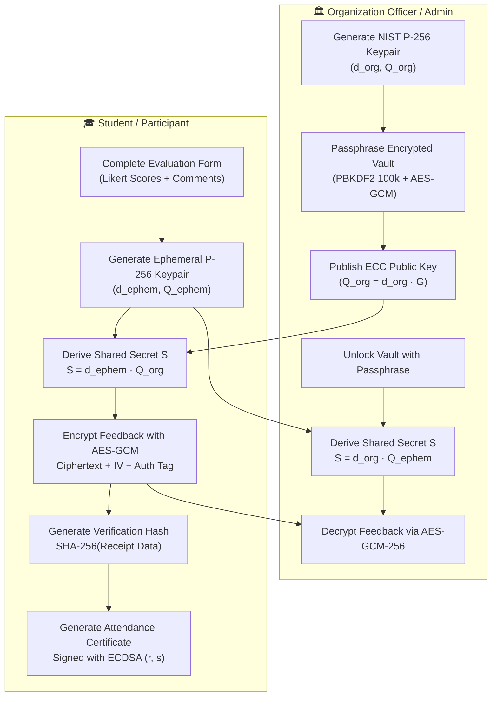

# Student Organization Event Evaluation Form — CRUD & ECC Architectural Plan

**Project**: Student Organization Event Evaluation System (`student-org-evaluation-form`)  
**Stack**: Vite + React 19 + JavaScript + Tailwind CSS  
**Security Standard**: Elliptic Curve Cryptography (NIST P-256: ECDH + AES-GCM-256 ECIES & ECDSA Digital Signatures)  
**Location**: `Desktop/JINFANTE/Student_Evaluation`  
**Author**: James Marc / Leif Joshua Infante  
**Date**: November 2026  

---

## 1. Executive Summary & Objective

This document defines the comprehensive architectural roadmap and technical specification to expand the existing **Student Organization Event Evaluation System** into an enterprise-grade, fully functional **CRUD application** powered by **Elliptic Curve Cryptography (ECC)**.

Strict constraints followed:
1. **Pure Vite + React + JavaScript**: High performance, zero unnecessary overhead.
2. **Zero-Modals Policy**: All creation, editing, viewing, and deletion operations happen inline via expandable accordions, drawers, split master-details, or stepped stages — **NO popup/modal dialogs**.
3. **Dual ECC Security Architecture**:
   - **Confidentiality**: Ephemeral-Static ECDH key agreement on NIST curve `P-256` paired with `AES-GCM-256` (ECIES hybrid encryption) for end-to-end qualitative feedback privacy.
   - **Authenticity & Integrity**: `ECDSA` digital signatures on curve `P-256` with `SHA-256` for tamper-evident Certificate of Attendance verification slips.
4. **Full CRUD on All System Entities**:
   - **Evaluations / Feedback Submissions**: Create, Read, Update, Delete.
   - **Student Organization Events**: Create, Read, Update, Delete.
   - **Continuous Improvement Action Plans**: Create, Read, Update, Delete.
   - **Evaluation Question Templates & Categories**: Create, Read, Update, Delete.

---

## 2. Existing Codebase Audit & Gap Analysis

Based on our inspection of the existing codebase in `Desktop/JINFANTE/Student_Evaluation`, the table below outlines the current state and required adjustments:

| Entity | Operation | Current State | Required Adjustments |
| :--- | :--- | :--- | :--- |
| **Org & Config** | **Central Config** | ⚠️ Scattered in `mockData.js`. | **New**: Centralized config in `src/config/organizationConfig.js` for 1-click customization of Org Name, Short Code, President, **Adviser**, Events, and Color Palette. |
| | **UI Settings** | ⚠️ Read-only / minimal. | **New**: Inline "Organization Settings" drawer (zero modals) to update Name, Short Code, President, Adviser live in the UI. |
| **Evaluations** | **Create** | ✅ Implemented via 7-step `EvaluationForm` with ECDH encryption. | Add auto-save draft capability and pre-validation. |
| | **Read** | ✅ Implemented in `EvaluationsListInline` (Officer) and `MySlipsView` (Student). | Add advanced sorting, multi-attribute filtering, and export. |
| | **Update** | ⚠️ Limited: Officer can only change `actionPlanStatus`. | **New**: Allow student to edit submitted evaluation (ratings, comments) within open evaluation window; allow officer to add inline evaluation audit notes. |
| | **Delete** | ❌ Missing: No delete/withdraw function. | **New**: Allow student to withdraw/delete their evaluation inline with confirmation banner; allow officer/admin to void fraudulent submissions with audit logging. |
| **Events** | **Create** | ✅ Implemented in `RsoDashboard` (`addEvent`). | Add custom evaluation question criteria assignment and ECC key pair linkage. |
| | **Read** | ✅ Implemented across views (`StudentEventsView`, `RsoDashboard`, `UacscDashboard`). | Add search query by tags, date range, and modality filter. |
| | **Update** | ⚠️ Partial: Context has `updateEvent` and toggle open/close, but **no inline edit UI**. | **New**: Add complete inline Edit Event drawer in `RsoDashboard` to modify title, venue, speakers, schedule, and modality. |
| | **Delete** | ❌ Missing: No `deleteEvent` function or UI. | **New**: Add `deleteEvent` in context with cascade handling of associated evaluation responses and inline confirmation panel. |
| **Action Plans** | **Create** | ✅ Implemented in `ActionPlansPanel`. | Link directly to specific evaluation response IDs. |
| | **Read** | ✅ Implemented in `ActionPlansPanel`. | Add progress metrics and completion tracking. |
| | **Update** | ⚠️ Partial: Only status toggle. | **New**: Inline editing of title, assigned committee, target due date, and implementation notes. |
| | **Delete** | ❌ Missing: No delete function. | **New**: Inline delete with confirmation to remove redundant or cancelled action items. |
| **Templates** | **CRUD** | ⚠️ Static: Seeded in `mockData.js`, read-only. | **New**: Dynamic question builder enabling custom Likert criteria and text prompts per organization or event category. |

---

## 3. Cryptographic Security Architecture: Elliptic Curve Cryptography (ECC)

### 3.1 Curve Specification & Mathematical Foundation
- **Standard**: NIST `P-256` (FIPS 186-4, also known as `secp256r1` or `prime256v1`).
- **Equation**: $y^2 \equiv x^3 - 3x + b \pmod p$
- **Parameters**: 256-bit prime field $p = 2^{256} - 2^{224} + 2^{192} + 2^{96} - 1$.
- **Security Equivalent**: Provides ~128 bits of symmetric security strength, equivalent to 3072-bit RSA, with dramatically lower computational overhead and compact key representations.

### 3.2 Dual ECC Cryptographic Flow Diagram



### 3.3 Protocol 1: Confidentiality via ECDH + AES-GCM (ECIES)
1. **Public Key Discovery**: When a student evaluates an event, the system loads the hosting organization's verified ECC Public Key ($Q_{org} \in E(\mathbb{F}_p)$).
2. **Ephemeral Agreement**:
   - Student's client generates a one-time ephemeral ECC private key $d_e \in [1, n-1]$ and ephemeral public key $Q_e = d_e \cdot G$.
   - Using ECDH key agreement: $S = d_e \cdot Q_{org} = d_e \cdot (d_{org} \cdot G) = d_{org} \cdot (d_e \cdot G) = d_{org} \cdot Q_e$.
3. **Symmetric Encryption**:
   - Derive a 256-bit `AES-GCM` key from shared point $S$.
   - Encrypt sensitive qualitative comments (highlights, constructive criticisms, recommendations) using a fresh 96-bit random Initialization Vector ($IV$).
   - Output bundle: `{ ephemeralPublicKeyJwk, iv, ciphertext, scheme: 'ECDH-P256-AES-GCM-256' }`.
4. **Authorized Decryption**:
   - Only the RSO officer possessing the matching private key $d_{org}$ (unlocked locally via their secure passphrase) can compute $S = d_{org} \cdot Q_e$ and decrypt the evaluation comments.

### 3.4 Protocol 2: Authenticity via ECDSA Digital Signatures
1. **Certificate Digest**: When the evaluation is confirmed, an attendance receipt summary is serialized:
   $$\text{Digest} = \text{SHA-256}(\text{ResponseId} \parallel \text{EventId} \parallel \text{StudentId} \parallel \text{Timestamp})$$
2. **Digital Signing**:
   - The receipt digest is signed using ECDSA with NIST curve `P-256` and `SHA-256`, producing signature pair $(r, s)$.
3. **Tamper-Evident Verification**:
   - The generated Certificate of Attendance displays a "Verify Authenticity" interactive badge.
   - Any verifier (e.g. university faculty or OSA administrator) can click "Verify Signature" using the Organization's published Public Key to confirm that the evaluation receipt has not been tampered with or fabricated.

### 3.5 Key Storage & Vault Security
- **No Plaintext Private Keys**: Private keys are never stored in raw plaintext in `localStorage`.
- **Passphrase Encryption**: Private keys are wrapped using `PBKDF2` (100,000 SHA-256 iterations) + `AES-GCM-256` with a unique 128-bit salt and 96-bit IV before saving to `localStorage`.
- **Session Memory**: Unlocked private keys reside only in ephemeral React context memory and are cleared upon role switch or page unload.

---

## 4. Complete CRUD Implementation Blueprint

### 4.1 Evaluation Submissions CRUD
- **Create (C)**:
  - Multi-step inline stepper (Profile $\rightarrow$ Program $\rightarrow$ Speakers $\rightarrow$ Logistics $\rightarrow$ Qualitative Feedback with ECC toggle $\rightarrow$ Inline Review $\rightarrow$ Certificate).
  - Client-side duplicate check (prevents double-submission by the same non-anonymous student).
  - Ephemeral ECC encryption executed in Web Cryptography API before local state dispatch.
- **Read (R)**:
  - *Student View* (`MySlipsView.jsx`): Card grid displaying submitted evaluations with receipt code, ECC encryption badge, and view details action.
  - *Officer View* (`EvaluationsListInline.jsx`): Master-detail split pane and table with filter by event, rating, and keyword search. Inline accordion expansion reveals all scores and ECC Decrypt button.
  - *Council/Admin View* (`UacscDashboard.jsx` & `AdminGovernance.jsx`): Aggregate charts, sentiment breakdown, and institutional KPIs.
- **Update (U)**:
  - *Student Edit Mode*: If the event evaluation is still `OPEN`, student can click "Edit Evaluation" on their slip. The form loads with existing scores and decrypted comments, allowing revisions and re-submitting with a new timestamp and updated verification signature.
  - *Officer Administrative Update*: Officer can update response evaluation status (`IN_REVIEW`, `ACTION_PLANNED`, `ARCHIVED`) and add internal committee notes inline.
- **Delete (D)**:
  - *Student Withdrawal*: Student can click "Withdraw / Delete Evaluation" inline with a double-confirmation banner.
  - *Admin / Officer Voiding*: Admin can delete flagged or duplicate submissions with an automatic audit trail entry recorded in `auditLogs`.

### 4.2 Organization Events CRUD
- **Create (C)**:
  - Collapsible inline form in `RsoDashboard.jsx` with validation for title, category, date, time, venue, modality (In-Person, Online, Hybrid), speakers, expected attendees, and ECC encryption requirement.
- **Read (R)**:
  - Event cards in `StudentEventsView.jsx` with real-time indicators: "Evaluation Open", "Upcoming", or "Closed".
  - Search by event title, organizer, category, or tags.
- **Update (U)**:
  - Inline "Edit Event" panel in `RsoDashboard.jsx` allowing officers to:
    - Update event details (schedule, venue, speakers).
    - Toggle evaluation status (`OPEN` vs `CLOSED`).
    - Adjust expected attendee targets.
- **Delete (D)**:
  - "Delete Event" button with inline confirmation.
  - Options: Cascade-delete associated evaluations or reassign them to an archived status.

### 4.3 Action Plans CRUD
- **Create (C)**: Inline form to create an action plan directly from feedback findings.
- **Read (R)**: Status list categorized into `IN_PROGRESS`, `UNDER_REVIEW`, and `RESOLVED`.
- **Update (U)**: Inline editing of action title, committee assignee, target due date, and resolution remarks.
- **Delete (D)**: Delete action plan with confirmation.

---

## 5. File Architecture & Planned Code Adjustments

```
Student_Evaluation/
├── src/
│   ├── components/
│   │   ├── admin/
│   │   │   └── AdminGovernance.jsx          # Add Org Edit/Delete & Template CRUD
│   │   ├── common/
│   │   │   ├── Navbar.jsx                   # Role switcher & navigation
│   │   │   ├── StarRating.jsx               # Rating widget
│   │   │   └── LikertScale.jsx              # Agreement scale
│   │   ├── crypto/
│   │   │   └── EccPlayground.jsx            # ECC visualizer (curve math, ECDH, ECDSA)
│   │   ├── officer/
│   │   │   ├── ActionPlansPanel.jsx         # Add Edit/Delete CRUD for action plans
│   │   │   ├── EccKeyVaultPanel.jsx         # Vault unlock, export JWK/PEM, key gen
│   │   │   ├── EvaluationsListInline.jsx    # Add Response Edit/Delete & Admin remarks
│   │   │   └── RsoDashboard.jsx             # Add Event Edit & Event Delete inline panels
│   │   └── student/
│   │       ├── EvaluationForm.jsx           # Support Edit mode for existing responses
│   │       ├── MySlipsView.jsx              # Add Edit and Delete/Withdraw actions
│   │       └── StudentEventsView.jsx        # Event catalog
│   ├── context/
│   │   ├── AuthContext.jsx                  # User authentication & role switching
│   │   ├── CryptoContext.jsx                # ECC Key vault + ECDH + ECDSA methods
│   │   └── EvaluationContext.jsx            # Full CRUD state handlers & localStorage sync
│   ├── data/
│   │   └── mockData.js                      # Seed data with P-256 public keys
│   └── utils/
│       ├── analytics.js                     # KPI metrics & distributions
│       ├── cryptoUtils.js                   # Web Crypto: ECDH, AES-GCM, ECDSA, PBKDF2
│       └── exportCsv.js                     # CSV exporter
├── CRUD_ECC_IMPLEMENTATION_PLAN.md          # THIS SPECIFICATION
├── PROJECT_PLAN.md                          # High-level roadmap
├── package.json
└── vite.config.js
```

---

## 6. Execution Roadmap & Milestones

1. **Step 1: Cryptographic Engine Extension (`cryptoUtils.js` & `CryptoContext.jsx`)**
   - Implement `generateEcdsaKeyPair()` or dual-usage NIST P-256 key handling.
   - Implement `signAttendanceCertificate(privateKey, data)` and `verifyAttendanceCertificate(publicKey, signature, data)`.
   - Add educational curve diagnostics (curve parameters, generator point $G$, scalar point visualization).

2. **Step 2: Full CRUD State in `EvaluationContext.jsx`**
   - Add `updateEvaluation(responseId, updatedData)`.
   - Add `deleteEvaluation(responseId)`.
   - Add `updateEvent(eventId, updatedFields)`.
   - Add `deleteEvent(eventId)`.
   - Add `updateActionPlan(planId, updatedFields)`.
   - Add `deleteActionPlan(planId)`.
   - Add `updateOrganization(orgId, updatedFields)` and `deleteOrganization(orgId)`.

3. **Step 3: Student View CRUD Enhancements**
   - Update `MySlipsView.jsx`: Add inline "Edit Submission" and "Withdraw / Delete" buttons with confirmation banners.
   - Update `EvaluationForm.jsx`: Support editing mode when initialized with existing response ID; regenerate signature upon update.

4. **Step 4: RSO Officer View CRUD Enhancements**
   - Update `RsoDashboard.jsx`: Add inline "Edit Event" form drawer and "Delete Event" button.
   - Update `EvaluationsListInline.jsx`: Add inline response deletion and administrative notes editing.
   - Update `ActionPlansPanel.jsx`: Add inline edit and delete controls.

5. **Step 5: Admin & Template CRUD Enhancements**
   - Update `AdminGovernance.jsx`: Add editing and deletion of organizations and custom survey templates.

6. **Step 6: Quality Assurance, Verification & Build**
   - Run `oxlint` to eliminate any warnings/unused variables.
   - Run `npm run build` to confirm production bundle integrity.
   - Verify zero modals across all newly added CRUD flows.
