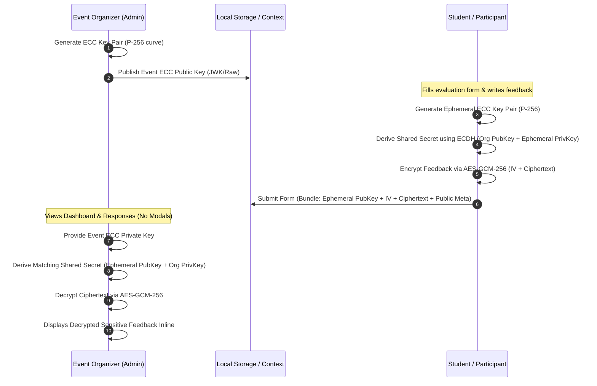

# Student Organizations Event Evaluation System
## Architecture, Technical Specification & Implementation Plan (Updated)

### 1. Executive Summary
The **Student Organizations Event Evaluation System** is a responsive, web-based frontend application built with **Vite, React, JavaScript, and Tailwind CSS**. 

**Key Principles & Revisions**:
1. **Zero Modals Policy**: All interactions (pre-submission review, response inspections, certificate downloads, key configurations) will be built as **inline components** (expandable panels, collapsible accordion sections, slide-over side sheets, or dedicated stepper stages) — **NO popup/modal dialogs**.
2. **Elliptic Curve Cryptography (ECC) Security**: Full end-to-end cryptographic privacy for evaluation feedback utilizing native **Web Cryptography API** (`ECDH` with curve `P-256` + `AES-GCM-256` ECIES hybrid encryption, and optional `ECDSA` digital signatures for certificate authenticity).
3. **Tailwind CSS Design System**: Clean, modern, accessible design with zero intrusive popups.

---

### 2. Cryptographic Architecture (ECC Encryption & Decryption)



#### ECC Technical Details:
- **Algorithm**: `ECDH` (Elliptic Curve Diffie-Hellman) on NIST `P-256` (prime256v1) curve.
- **Symmetric Cipher**: `AES-GCM` with 256-bit key length and 96-bit initialization vector (`IV`).
- **Standard**: Standard ECIES (Elliptic Curve Integrated Encryption Scheme) implemented cleanly using the browser's native `window.crypto.subtle`.
- **Key Serialization**: JSON Web Key (`JWK`) and Hex string formats for easy copying, inspection, and organizer key import/export.
- **Privacy Mode**: Students can choose whether to encrypt only sensitive qualitative comments or the entire submission identity + feedback.

---

### 3. UI/UX Architecture: Zero Modals Guarantee

All views previously considered for modals are redesigned into seamless inline flows:

| Former Modal Concept | Non-Modal Implementation |
| :--- | :--- |
| **Pre-Submission Review Modal** | **Step 5: Review & Confirm Page**: An inline interactive summary step within the multi-step form before final submission. |
| **Response Detail Inspection Modal** | **Inline Expandable Drawer / Split Pane**: Organizer can click any submission row to expand an inline details card directly beneath or side-by-side in a split master-detail view. |
| **Certificate of Attendance Modal** | **Inline Certificate Generator Card**: Displayed directly on the submission completion screen with print/download actions embedded on the page. |
| **ECC Key Management Modal** | **Dedicated Inline Security / Encryption Center Tab**: A persistent section on the dashboard where organizers can generate keys, export public keys, paste private keys, and decrypt records inline. |

---

### 4. Component & Folder Structure

```
student-org-evaluation-form/
├── public/
├── src/
│   ├── components/
│   │   ├── common/
│   │   │   ├── Navbar.jsx               # Header with branding, view switcher, & active event
│   │   │   ├── StarRating.jsx           # 1-5 Star interactive rating widget
│   │   │   ├── LikertScale.jsx          # 1-5 Agreement scale component
│   │   │   ├── Badge.jsx                # Modality, Department & Security status badges
│   │   │   └── Card.jsx                 # Styled Tailwind container card
│   │   ├── crypto/
│   │   │   ├── EccKeyManager.jsx        # Inline ECC Key generation, export/import panel
│   │   │   ├── EncryptionStatusBadge.jsx# Live indicator showing encryption state
│   │   │   └── EccPlayground.jsx        # Interactive ECC test bench (Encrypt/Decrypt sandbox)
│   │   ├── evaluation/
│   │   │   ├── EventHero.jsx            # Event branding, org details & public key status
│   │   │   ├── EvaluationForm.jsx       # Multi-step form controller
│   │   │   ├── StepProfile.jsx          # Attendee profile & anonymity options
│   │   │   ├── StepContent.jsx          # Program content & objectives rating
│   │   │   ├── StepSpeakers.jsx         # Speaker & facilitator rating
│   │   │   ├── StepLogistics.jsx        # Logistics, venue & AV rating
│   │   │   ├── StepComments.jsx         # Qualitative feedback with ECC toggle
│   │   │   ├── StepReview.jsx           # INLINE review step (no modal)
│   │   │   └── StepSuccess.jsx          # INLINE completion slip & certificate view
│   │   └── dashboard/
│   │       ├── DashboardView.jsx        # Organizer master view
│   │       ├── MetricCard.jsx           # Real-time analytics KPI cards
│   │       ├── AnalyticsCharts.jsx      # Recharts bar, radar, and distribution graphs
│   │       ├── ResponsesMasterDetail.jsx# Split/accordion response viewer (no modal)
│   │       ├── ResponseDetailPane.jsx   # Inline expanded submission view with ECC Decrypt button
│   │       └── ExportPanel.jsx          # CSV and JSON report export controls
│   ├── context/
│   │   ├── EvaluationContext.jsx        # Evaluations, active events, and form store
│   │   └── CryptoContext.jsx            # Active ECC keys, key derivation, and crypto store
│   ├── data/
│   │   ├── mockEvents.js                # University student org events with pre-generated ECC keys
│   │   └── mockResponses.js             # Realistic evaluation responses (pre-encrypted & plaintext)
│   ├── utils/
│   │   ├── cryptoUtils.js               # Web Crypto API helpers: generateKey, deriveKey, encrypt, decrypt, export/import
│   │   ├── exportCsv.js                 # Client-side CSV generator
│   │   └── analytics.js                 # KPI math (averages, distributions, NPS)
│   ├── App.jsx                          # View routing (Evaluation Form vs. Organizer Dashboard)
│   ├── index.css                        # Tailwind CSS styles
│   └── main.jsx                         # React entry point
├── PROJECT_PLAN.md
├── README.md
├── package.json
└── vite.config.js
```

---

### 5. Detailed Step-by-Step Implementation Roadmap

- **Phase 1: Project Scaffolding & Tailwind CSS Setup**
  - Scaffold Vite React JavaScript application.
  - Install dependencies: `lucide-react`, `recharts`, and `@tailwindcss/vite` (or Tailwind CSS v3/v4).
  - Verify strict adherence to **no modal dialogs**.

- **Phase 2: ECC Cryptography Engine (`cryptoUtils.js` & `CryptoContext.jsx`)**
  - Implement native Web Crypto API wrappers:
    - `generateEccKeyPair()`: Generates `ECDH` P-256 curve keypair.
    - `exportKeyToJwk()` / `importKeyFromJwk()`: Serializes public/private keys.
    - `encryptWithEccPublicKey()`: Performs ephemeral ECDH key agreement + AES-GCM-256 encryption.
    - `decryptWithEccPrivateKey()`: Derives shared secret from ephemeral public key and decrypts ciphertext.
  - Implement `CryptoContext` providing global key access, current organizer key status, and quick decrypt functions.

- **Phase 3: Multi-Step Evaluation Form (Pure Inline Progression)**
  - Event Hero with Org info and ECC secure badge.
  - Step 1: Attendee Information (optional anonymity, college, year, modality).
  - Step 2: Content & Objectives (1–5 Likert scale).
  - Step 3: Speaker Assessment (1–5 Likert scale).
  - Step 4: Logistics & Platform (1–5 Likert scale).
  - Step 5: Qualitative Feedback with option to enable ECC End-to-End Encryption.
  - Step 6: **Inline Review & Confirm** (shows formatted summary before submission; no modal).
  - Step 7: **Inline Submission Slip** with printable acknowledgment certificate.

- **Phase 4: Organizer Dashboard with Inline ECC Decryption**
  - KPI Stat Cards (Total Submissions, Average Rating, Net Promoter Score, Encrypted Feedback ratio).
  - Recharts visual graphs (Category scores, Star distribution, Attendance modalities).
  - **Master-Detail / Inline Accordion Response Viewer**:
    - Table of responses with status badges (`Encrypted` vs `Plaintext`).
    - Clicking a row expands the detail view inline.
    - If response is encrypted, includes an inline **"Decrypt with Organizer Private Key"** action button that reveals plaintext in place without any popup.
  - Inline ECC Key Manager tab allowing organizers to generate, copy, or load private keys.
  - CSV and JSON export engines.

- **Phase 5: Event Switcher & End-to-End Testing**
  - Preset student org events (e.g. Computing Society, Creative Arts Guild, Student Council).
  - Comprehensive testing of:
    - Rating submissions with ECC encryption enabled.
    - Inline decryption on organizer dashboard.
    - Responsive layout on mobile and desktop screens with zero modals.
